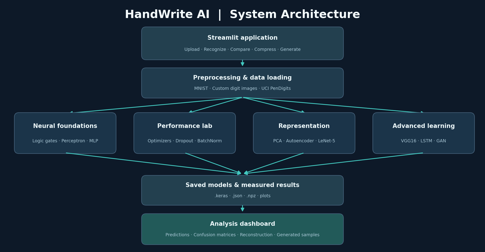

# HandWrite AI

### An Intelligent Handwriting Recognition, Analysis and Generation System

A **Deep Learning Foundations final-year capstone** integrating all ten prescribed practicals into a single reproducible experiment suite and interactive Streamlit dashboard.



## What is included

- A Streamlit dashboard for drawing or uploading handwritten digit images, recognizing digits, comparing trained models, compressing/reconstructing digits, generating GAN samples, and visualizing LSTM stroke predictions.
- A **working offline 8×8 digit recognition demo** using scikit-learn's bundled digit dataset. This is a separate logistic-regression baseline, **not** the MNIST MLP/CNN.
- TensorFlow/Keras implementations for MLP backpropagation, SGD/RMSProp/Adam comparison, PCA vs Autoencoder, Dropout vs Batch Normalization, LeNet-5-inspired CNN, pretrained VGG16 transfer learning, LSTM next-coordinate prediction, and an unconditional GAN.
- McCulloch–Pitts neuron logic gates and a binary MNIST Perceptron (0 versus 1).
- JSON experiment metrics, training histories, confusion matrices, and image comparisons, saved only after real experiments run.
- Automated unit tests for non-TensorFlow modules.

**Important:** The downloadable source does **not** contain pretrained MNIST/VGG16/GAN model weights or invented results. Each actual model must be trained before its dashboard page can display predictions or test results. The offline 8×8 demo works immediately.

## Install

Recommended: **Python 3.11 or 3.12**, 64-bit, with a virtual environment and an internet connection for the first dataset/model-weight download.

```bash
cd HandWrite_AI
python -m venv .venv
```

Activate the virtual environment:

```bash
# Windows PowerShell
.venv\Scripts\Activate.ps1

# macOS / Linux
source .venv/bin/activate
```

Install the full environment:

```bash
python -m pip install --upgrade pip
python -m pip install -r requirements.txt
```

If TensorFlow cannot be installed on your computer, the offline demonstration and dashboard can run with:

```bash
python -m pip install -r requirements-demo.txt
```

Then:

```bash
streamlit run app.py
```

Streamlit prints a local browser URL (normally `http://localhost:8501`). On Windows, `start_windows.bat` launches the same app after dependencies are installed. On macOS/Linux, use `bash start_linux_mac.sh`. The dashboard includes a bundled HTML drawing pad, so no extra canvas package or CDN is required.

## Training commands

Run all commands from the project root:

```bash
# No download required
python -m scripts.train logic

# MNIST required; first run downloads the dataset
python -m scripts.train perceptron
python -m scripts.train mlp
python -m scripts.train optimizers
python -m scripts.train compression
python -m scripts.train regularization
python -m scripts.train lenet
python -m scripts.train gan

# UCI PenDigits download required
python -m scripts.train lstm

# Requires your own labeled handwritten images and ImageNet VGG16 weights
python -m scripts.train transfer --custom-data data/custom_digits
```

Quick **smoke tests** with only 2,000 training images and one epoch:

```bash
python -m scripts.train lenet --quick
python -m scripts.train optimizers --quick
python -m scripts.train compression --quick
```

Quick tests do **not** establish final model quality. GAN training typically needs substantially more iterations than one epoch to produce meaningful images.

For final evaluation on the entire MNIST test set:

```bash
python -m scripts.train lenet --epochs 10 --train-limit 0 --test-limit 0
```

**By default** MNIST experiments limit training to 12,000 examples and testing to 2,000 examples for accessibility. The test set remains held out, but reported accuracy is for that subset. Set `--train-limit 0 --test-limit 0` for full-split results. Validation uses 5,000 samples drawn from MNIST training data and is not reused as the final test set.

## Practical coverage

| # | Practical | File/module | Train command |
|---|---|---|---|
| 1 | McCulloch–Pitts logic gates | `handwrite_ai/logic.py` | `logic` |
| 2 | Perceptron binary classification | `experiments.run_perceptron` | `perceptron` |
| 3 | MLP + backpropagation | `models.mlp` | `mlp` |
| 4 | SGD, RMSProp, Adam comparison | `experiments.run_optimizers` | `optimizers` |
| 5 | PCA vs Autoencoder | `models.autoencoder` / `run_compression` | `compression` |
| 6 | Dropout + Batch Normalization | `models.mlp` / `run_regularization` | `regularization` |
| 7 | LeNet-5-inspired image classification | `models.lenet` | `lenet` |
| 8 | VGG16 frozen-backbone transfer learning | `models.vgg16_transfer` | `transfer` |
| 9 | LSTM next pen-coordinate prediction | `models.stroke_lstm` | `lstm` |
| 10 | Unconditional GAN digit generation | `models.gan_models` | `gan` |

`python -m scripts.train all` attempts the entire suite, including datasets requiring separate downloads. A missing transfer-learning dataset is skipped in that mode; other failures are surfaced instead of silently producing fabricated results.

## Custom dataset for VGG16

Organize handwritten digit images as:

```text
data/custom_digits/
├── train/
│   ├── 0/ ... images of zero
│   ├── 1/ ... images of one
│   └── ...
├── val/
│   ├── 0/ ...
│   └── ...
└── test/
    ├── 0/ ...
    └── 9/ ...
```

All three splits must contain class folders **0 through 9**. For credible generalization, separate writers between training and test sets whenever possible. Do **not** reuse the test folder during training. Images are resized to 96×96 RGB and passed through the official VGG16 preprocessing; the ImageNet-pretrained convolutional backbone is frozen. The pretrained weights are downloaded separately by Keras.

*VGG16 input note:* Keras VGG16 accepts 3-channel images with spatial dimensions ≥32 when `include_top=False`; the system uses 96×96 to reduce memory requirements. The VGG16 `preprocess_input` function expects raw 0–255 RGB image arrays and performs its own channel handling and centering.

## LSTM dataset clarification

The UCI **Pen-Based Recognition of Handwritten Digits** dataset contains eight (x,y) points per digit, derived from spatially resampled pen trajectories. These are **ordered locations, not equally spaced time observations**. The LSTM predicts a next point given preceding coordinates. This is sequence prediction but should not be presented as timestamp-based handwriting velocity prediction.

The downloader fetches `pendigits.tra` and `pendigits.tes` from:

`https://archive.ics.uci.edu/ml/machine-learning-databases/pendigits/`

If download is unavailable, put both files manually under `data/pendigits/`, or supply `--pendigits-dir /path/to/folder`.

## Evaluation and limitations

- Save and compare **actual** held-out test accuracy, loss and confusion matrices for classification.
- Check training versus validation curves to detect overfitting.
- Compare PCA and Autoencoder via pixel reconstruction MSE at the same 32-dimensional bottleneck; results do not automatically imply better downstream classification.
- The GAN is **unconditional**. It cannot generate a requested numeral class without a conditional-GAN extension.
- A randomly initialized or insufficiently trained GAN can output noise. Loss values alone do not establish sample quality.
- Uploaded handwriting may differ substantially from MNIST or the offline digits dataset.
- The offline baseline trains on the separate bundled scikit-learn 8×8 digits dataset; its test accuracy is not comparable to MNIST CNN accuracy without a shared evaluation dataset.
- The historic LeNet-5 used different subsampling and partial connectivity details. The project uses a **LeNet-5-inspired modern Keras implementation**, not an exact historical reproduction.

## Project structure

```text
HandWrite_AI/
├── app.py                         Streamlit interface
├── components/digit_pad/          bundled browser drawing canvas (no CDN)
├── handwrite_ai/
│   ├── config.py                  paths, reproducibility defaults
│   ├── datasets.py                MNIST / UCI PenDigits loading
│   ├── preprocessing.py           handwriting preprocessing
│   ├── models.py                  Keras model architectures
│   ├── experiments.py             all ten experiment implementations
│   ├── logic.py                   threshold-neuron gates
│   ├── demo.py                    offline baseline
│   ├── store.py                   result metadata and histories
│   └── charts.py                  plotting helpers
├── scripts/train.py               training CLI
├── scripts/check_environment.py    installation and demo verification
├── tests/                         unit tests
├── assets/                        architecture diagram
├── data/custom_digits/            dataset instructions
├── artifacts/                     actual trained weights / metrics (generated)
├── PROJECT_REPORT.md              capstone report draft/template
├── requirements.txt
└── requirements-demo.txt
```

## Run tests

```bash
python -m pip install pytest
python -m pytest -q
```

These tests check preprocessing, logic gates, windowing, CLI, and the offline baseline. Training/inference of TensorFlow models should additionally be tested in an environment where TensorFlow is installed.

## Academic integrity

The code is a complete **project implementation** but not a claim that all ten full training experiments have been executed. Do not copy example metrics from external sources into a report. Run the experiments, collect the generated `artifacts/*.json`, and cite them as your measured results.

## References

- TensorFlow/Keras: https://www.tensorflow.org/guide/keras
- Keras VGG16: https://keras.io/api/applications/vgg/vgg_models/
- UCI PenDigits dataset: https://archive.ics.uci.edu/dataset/81/pen+based+recognition+of+handwritten+digits
- MNIST (Keras): https://keras.io/api/datasets/mnist/
- Scikit-learn digits: https://scikit-learn.org/stable/modules/generated/sklearn.datasets.load_digits.html
